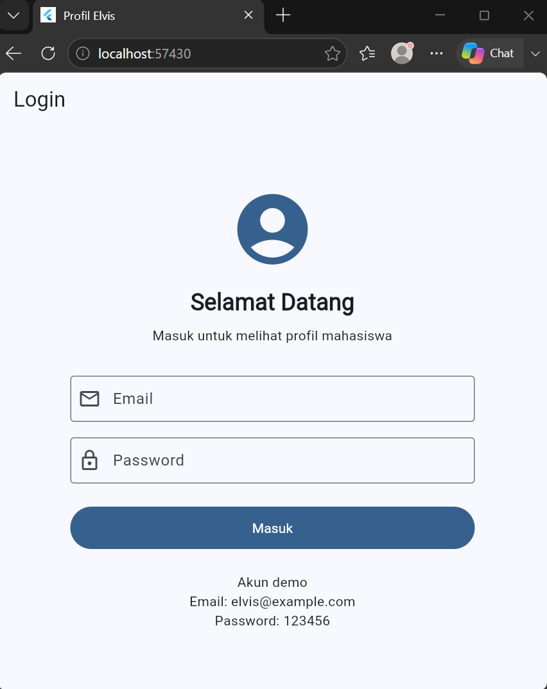
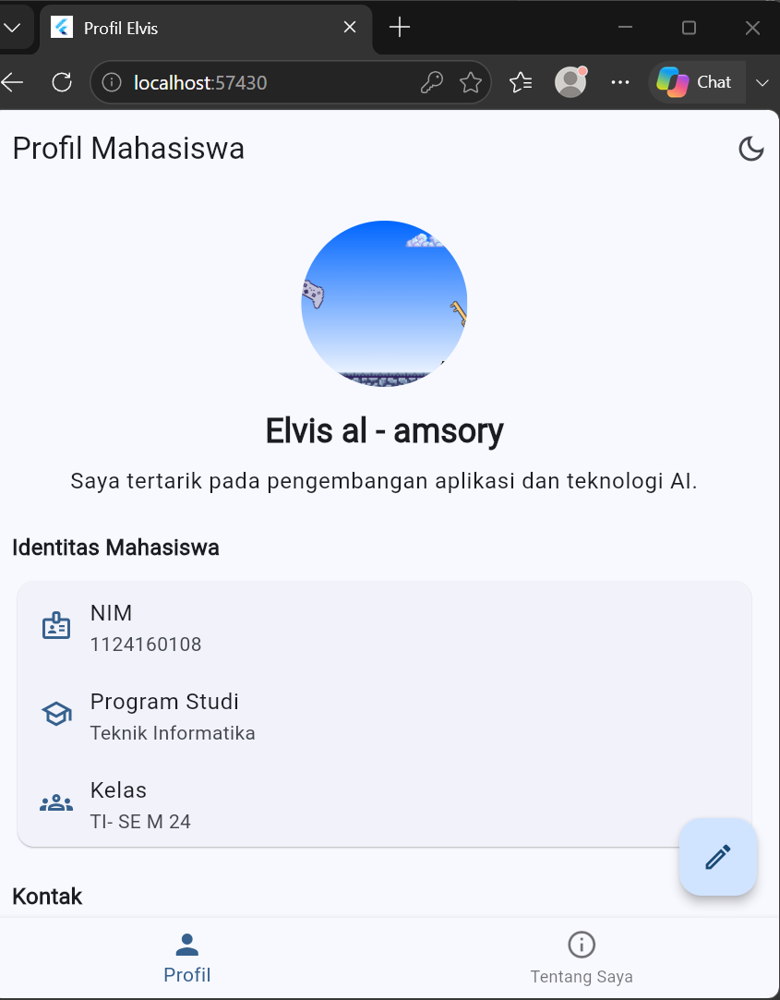
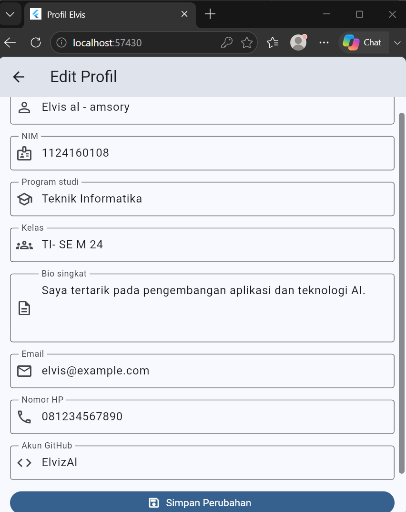
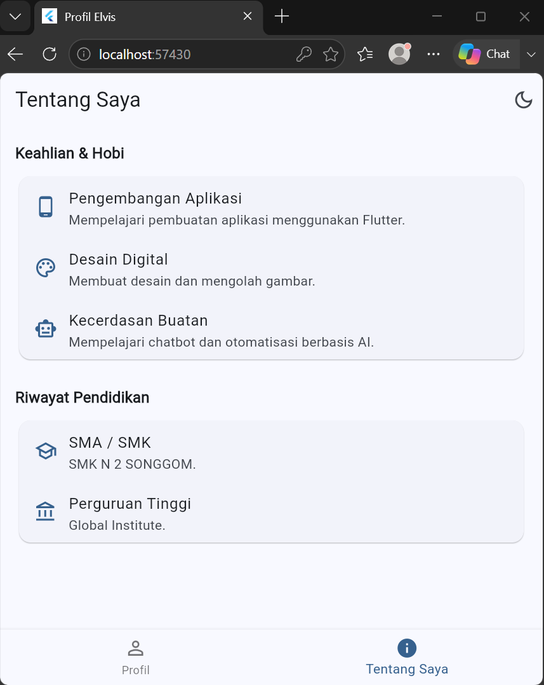

# Profil Elvis — Aplikasi Profil Mahasiswa

Aplikasi Flutter Android untuk tugas UTS Pemrograman Mobile, Soal 2. Aplikasi menyediakan login demo, profil mahasiswa, edit profil, dan halaman tentang saya. Data disimpan di memori tanpa server atau database; perubahan profil akan hilang ketika aplikasi dimulai ulang.

## Identitas

| Keterangan | Data |
| --- | --- |
| Nama | Elvis Al-Amsory |
| NIM | 1124160108 |
| Program studi | Teknik Informatika |
| Kelas | TISE24 M |
| GitHub | [ElvizAl](https://github.com/ElvizAl) |

## Fitur

- Login menggunakan `Form`, validasi email dan password, indikator loading, serta `pushReplacement` menuju halaman profil.
- Profil menampilkan foto dari `assets/images/profil.jpg` melalui `CircleAvatar`, nama, NIM, program studi, kelas, dan bio.
- Kontak email, nomor HP, dan akun GitHub ditampilkan menggunakan `Card` dan `ListTile` dengan ikon.
- Edit profil dengan nilai awal dari `TextEditingController`. Nama wajib diisi, email harus valid, dan nomor HP hanya menerima angka sepanjang 10–13 digit.
- Simpan profil mengembalikan data melalui `Navigator.pop(context, dataBaru)` dan langsung memperbarui halaman profil menggunakan `setState()`.
- Halaman Tentang Saya menggunakan `ListView` untuk menampilkan pengembangan aplikasi, desain digital, kecerdasan buatan, dan riwayat pendidikan.
- Navigasi Profil dan Tentang Saya melalui `BottomNavigationBar`, serta `FloatingActionButton` untuk membuka edit profil.
- Tema terang dan gelap dapat diganti langsung melalui tombol pada `AppBar` halaman utama.
- Nama aplikasi Android: **Profil Elvis**.

## Cara Menjalankan

Siapkan Flutter SDK dengan Dart yang memenuhi batas versi pada `pubspec.yaml` (`^3.13.7`), Android SDK, serta emulator Android atau HP Android dengan USB debugging aktif.

Dari folder utama repository, jalankan:

```sh
cd soal2_profil_app
flutter pub get
flutter devices
flutter run
```

Pilih perangkat Android jika tersedia beberapa perangkat. Untuk memilih perangkat secara langsung, gunakan `flutter run -d <ID_PERANGKAT>` dengan ID dari `flutter devices`.

## Akun Demo

| Email | Password |
| --- | --- |
| `elvis@gmail.com` | `123456` |

Login merupakan simulasi lokal. Gunakan akun di atas sesuai petunjuk pada halaman login.

## Video Presentasi YouTube

**Belum tersedia — tambahkan tautan video YouTube setelah video diunggah.**

Video perlu memperlihatkan aplikasi berjalan pada HP atau emulator Android, alur login, profil, edit dan simpan profil, halaman Tentang Saya, serta pergantian tema.

## Screenshot

Berikut empat screenshot aplikasi saat dijalankan melalui Flutter Web di browser.

### Login



### Profil



### Edit Profil



### Tentang Saya



## Struktur Kode

```text
lib/
├── main.dart
├── models/
│   └── profile.dart
├── screens/
│   ├── login_page.dart
│   ├── profile_page.dart
│   ├── edit_profile_page.dart
│   └── about_page.dart
└── widgets/
    ├── contact_card.dart
    ├── identity_card.dart
    ├── info_tile.dart
    ├── profile_header.dart
    ├── profile_text_field.dart
    └── section_title.dart
```

## Dependensi

Dependensi aplikasi hanya Flutter SDK dan `cupertino_icons`. Tidak ada paket tambahan di luar yang diizinkan soal. Untuk pengembangan, proyek menggunakan `flutter_test` dari Flutter SDK dan `flutter_lints` untuk pemeriksaan gaya kode.

## Build APK Release

Dari folder `soal2_profil_app`, jalankan:

```sh
flutter build apk --release
```

APK dihasilkan pada `build/app/outputs/flutter-apk/app-release.apk`. Unggah APK tersebut sebagai aset GitHub Releases dengan tag `v1.0.0`, tanpa memasukkan APK ke commit repository.

Build juga dapat dijalankan melalui tab **Actions → Build Android release APK → Run workflow** di GitHub. Workflow menggunakan Flutter 3.47.9, menjalankan analisis dan tes, lalu menyediakan artefak `profil-elvis-release` berisi APK.
